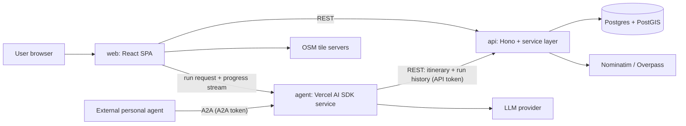
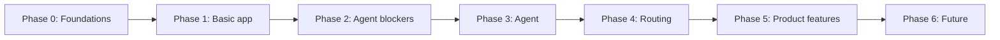

# Trip Planning - plan

The product is an **itinerary planning app**. Features revolve around aiding in trip planning and recording trip plans and displaying them with an UI. 

## Source of truth

| Question | Canonical doc |
|---|---|
| Project vision | This file, [End Goal](#end-goal) |
| Architectural decisions | This file, [Architecture](#architecture) |
| Implementation order | This file, [Implementation Plan](#implementation-plan) |
| How to implement a single step | `.cursor/steps/<step-id>.md` (written when the step is picked up) |

## End Goal

A web application that helps the user create and manage a travel itinerary. The user builds a plan for a trip, revises it as details change, and reads it back from a broad overview down to a single day.

The application:

- Stores the itinerary for long trips — path, times, lodging, destinations, and other notes — and lets the user create, edit, and remove that information.
- Lets the user move between levels of detail, from which days fall in which region to a detailed itinerary for a single day.
- Displays the itinerary clearly, with an interactive map.
- Exposes itinerary information to agents / LLMs for grounding.
- Calculates potential commute routes.
- Stores backup plans and situational information.

### Agent

The agent expects a set of inputs from the user, such as:
- location(s)
- desired destinations / preferred scenery types
- budget

With those inputs, the agent uses the application in place of the user to create an itinerary. It drives the same actions a person would take in the app:
- Creating, combining, editing, and deleting trips
- Calculating and picking routes

The itinerary it produces is the one stored in the application.

The agent should support being called by another, broader purpose agent outside the application.

---

## Architecture

### Decided stack

| Area | Decision |
|---|---|
| Language | TypeScript everywhere (Node 22+). No Python runtime. |
| Frontend | React SPA built with Vite, Tailwind CSS, TanStack Query (server state), TanStack Router |
| Maps | MapLibre GL rendering OpenStreetMap tiles |
| API backend | Hono, with Zod schemas + `@hono/zod-openapi` (OpenAPI doc) and a typed Hono RPC client |
| Database | PostgreSQL + PostGIS, accessed through Drizzle ORM, migrations via drizzle-kit |
| Agent service | Separate TypeScript service/container built on the Vercel AI SDK |
| LLM | Provider-agnostic; provider + model chosen by env config |
| Agent interface | A2A (Agent2Agent) protocol for the external general-purpose personal agent; web UI panel for the user |
| Agent execution | Each run is one synchronous request that creates, edits, or deletes one trip, streaming progress while it runs. Every run is recorded in Postgres for reference and backtracking. |
| Agent writes | Agent writes to a **draft** trip; the user (web UI) or the calling agent (A2A) accepts it |
| Places | OSM: Nominatim geocoding + Overpass POI search, behind a provider interface so fallbacks can be added |
| Routing | **Deferred** — provider chosen when the routing phase starts |
| Packaging | npm workspaces monorepo; Docker Compose for local runtime |
| Testing | Vitest across packages; agent evaluation scenarios in the agent phase |
| Users | Single user, no accounts. Machine callers use separate tokens for A2A and API. |
| Deployment | Local Docker Compose only; the personal agent runs on the same machine / local network |

### Repo layout

- `web/` — Vite React SPA
- `api/` — Hono app: HTTP handlers, service layer, Drizzle schema and migrations, place-search adapters
- `agent/` — agent service: LLM loop, tools, A2A server, UI streaming endpoint
- `shared/` — Zod schemas and derived types used by all three; the only package the others share
- Root: `package.json` (workspaces), `docker-compose.yml`, `.env.example`, shared TS/lint config

### System diagram

### Architectural principles

- **The agent is a client of the app, not part of it.** It reaches itinerary data only through the same REST API the web app uses, so anything the agent can do, the user can do, and the other way around.
- **Thin handlers, fat service layer.** HTTP handlers validate with Zod and call service functions; only the service layer touches the database or external geo providers.
- **Schemas live only in `shared/`.** API validation, the OpenAPI doc, the typed client, agent tool input schemas, and web forms all derive from them.
- **External providers sit behind interfaces.** Place search (and later routing) is an adapter with one OSM implementation first, so fallbacks and swaps don't touch callers.
- **Grow the schema additively.** New concepts (days, routes, backups, users) are new tables/columns, not reshapes of existing ones.
- **Leave room for accounts.** No user concept yet, but service functions take a request context object so ownership and authorization can be added later without changing signatures.

### Data model (direction, detailed per step)

- **Trip** — title, date range, budget, notes, status (`active` / `draft`), optional reference to the trip a draft was derived from.
- **Day** — belongs to a trip; date, optional region label, notes.
- **Place / Location** — named point (`geometry(Point, 4326)`), optional source reference (e.g. OSM id), notes.
- **Itinerary item** — ordered entry on a day: place, time window, category (activity, lodging, transit, meal, ...), estimated cost, notes.
- **Agent run** — target trip, kind (create / edit / delete), the request, status (running / failed / discarded / accepted / reverted), ordered step events, result summary, the draft it produced, and snapshots of the trip before and after the change.
- **Later:** route segments (`geometry(LineString, 4326)`) between items, backup plans / alternatives, situational notes, users + ownership.
- UUID primary keys generated by the service layer; all coordinates SRID 4326.

### Agent architecture

- **One run, one change:** a run targets a single trip. It creates a trip from a brief, edits an existing trip from an instruction, or deletes an existing trip. The run lasts exactly as long as its request, and there is no job queue or resuming.
- **Inputs:** for creation, a brief (locations, preferred destinations / scenery types, budget, dates); for an edit or deletion, the target trip and an instruction. Both are Zod schemas in `shared/`, used by the A2A skills and the web panel.
- **Tools:** thin wrappers over the typed API client — trip/day/item CRUD, combine trips, place search, (later) route calculation. Tool schemas reuse `shared/` Zod schemas.
- **Output:** a draft of the change, streamed progress while the run executes, and a run record.
- **Draft lifecycle:** a run produces a new-trip draft, a draft copy of the existing trip, or a proposed deletion. Accepting it applies the change to the real trip; discarding it leaves the trip untouched. Accept and discard are available from both the web UI and A2A.
- **Run history (reference and backtracking only):** the API records each run's request, steps, and outcome. When a draft is accepted, it also stores snapshots of the trip before and after. If a request ends before the run finishes, the run is marked failed and its draft discarded.
- **Backtracking:** revert a trip to its state before any accepted run. That discards every later run and any hand edits made since, and the panel warns before it happens. Reverting a creation deletes the trip; reverting a deletion restores it. Reverted runs stay in history, marked as reverted.
- **Surfaces:** an A2A server (agent card, skills such as create-trip / edit-trip / delete-trip / accept-draft, progress streamed within the request) for the personal agent, and a streaming endpoint for the web panel.
- **Model config:** provider and model selected via env; no provider-specific code outside one module.

### Security (v1)

- Local-only deployment; no user accounts.
- Two separate machine credentials from env: one guarding the A2A surface, one used by the agent to call the API.
- CORS limited to the web origin.

### Deferred decisions

Recorded so they are not silently invented later:

- **Routing provider** (OpenRouteService, self-hosted OSRM, Google, ...) — decided at the start of the routing phase.
- **Place-search fallbacks** (commercial places APIs, LLM knowledge) — after the OSM adapter is in use.
- **Accounts and auth** — library and model chosen when multi-user is needed; the first step is a migration adding users + ownership.
- **Job queue for agent runs** (pg-boss, BullMQ, …) — history is stored without one. Add a queue only if in-process execution becomes a problem (restarts mid-run, runs longer than a request).
- **Remote deployment** (cloud host, HTTPS, backups) — only if the personal agent moves off the local machine.
- **MCP surface** for low-level itinerary tools — only if an agent needs raw tool access rather than A2A delegation.
- **Component library, form library, offline/PWA, image uploads** — when a feature needs them.

### Open decisions (to settle in the named step)

- **Web panel ↔ agent transport** (step 3.6): the web acts as an A2A client (one surface), or the agent exposes a separate SSE endpoint for the UI. Live progress and stored history are both available either way.
- **Browser authentication before accounts exist** (step 2.4): tokens protect machine-to-machine traffic, but the browser can't hold a secret; decide whether local-only web traffic stays open.
- **Budget modeling** (step 2.1): per-item cost estimates only, or also per-day / per-category budgets.
- **A2A library** (step 3.5): the official A2A JS SDK or a thin hand-rolled JSON-RPC server — verify SDK maturity first.

---

## Implementation Plan

Overview only. Each step gets a dedicated `.cursor/steps/<step-id>.md` with detailed instructions when it's picked up. The ordering gets a basic working app running, then builds whatever blocks the agent, then the agent itself. Other product features come after the agent works.

### Phase 0 — Foundations

**0.1 Package management and repo setup** (`0.1-workspace`)
- Root npm workspaces for `web`, `api`, `agent`, `shared`; shared TypeScript config, lint/format, Vitest.
- Root scripts for dev, build, test, lint, and DB tasks.
- `.env.example` covering DB, API, agent, LLM, and token settings.
- Remove the stale root `node_modules` from the earlier attempt before the first install.

**0.2 Docker setup** (`0.2-docker`)
- Compose services: `db` (PostGIS image, persistent volume, healthcheck), then `api`, `web`, and `agent` as they come online.
- Dev-mode containers with source mounts and hot reload; one command brings the stack up.
- A way to run migrations and seeds inside the stack.

**0.3 Database architecture** (`0.3-db`)
- Drizzle setup in `api/`, drizzle-kit migration workflow, PostGIS enabled in the first migration.
- Geometry column handling (custom type or SQL helpers) settled once, here.
- Initial tables: trips and locations only. Seed script with a sample trip.

### Phase 1 — Basic functioning application

Goal: in Docker, the user can create a trip, add locations, and see them on a map.

**1.1 Shared schemas** (`1.1-shared`)
- Zod schemas and types for trips and locations; the pattern later schemas follow.

**1.2 API core** (`1.2-api`)
- Hono app with health check, error handling, CORS, config loading.
- Service layer + resource routes for trips and locations (CRUD).
- OpenAPI doc served from the app; typed RPC client exported for web and agent.

**1.3 Web core** (`1.3-web`)
- Vite + React + Tailwind + TanStack Router/Query scaffold.
- Trip list, trip detail with MapLibre map, add/edit/remove locations (click on map, edit form).

**1.4 Basic app milestone** (`1.4-verify`)
- Full stack runs from Compose; smoke tests for API and a manual UI walkthrough.

### Phase 2 — Blocking components for the agent

Goal: the API can represent everything the agent needs to produce and hand off an itinerary.

**2.1 Itinerary model** (`2.1-itinerary-model`)
- Days, itinerary items (time window, category, cost), trip budget — schema, service, routes, shared schemas.
- Minimal web views so agent output is readable (day list + items on the map); no polish yet.

**2.2 Drafts and trip operations** (`2.2-drafts`)
- Trip status (`draft` / `active`); a draft is a new trip, a copy of an existing trip, or a proposed deletion of one.
- Accept (promote, replace the original, or delete) and discard operations.
- Combine trips operation.
- Web: draft badge, review view, accept / discard buttons.

**2.3 Place search** (`2.3-places`)
- Place-search provider interface in the API; OSM adapter using Nominatim (geocoding) and Overpass (POI by category/tags near a location or inside an area).
- Respect provider usage policies: rate limiting, identifying user agent, caching of results.
- API endpoints for search; web search box to add a location from results.

**2.4 Machine credentials** (`2.4-tokens`)
- API token middleware for non-browser callers; A2A token config for the agent service.
- Settle the browser-auth open decision.

### Phase 3 — Agent

Goal: the personal agent (via A2A) or the user (via the web panel) asks for one change to one trip — create, edit, or delete — and gets a reviewable draft in the same request. Every run is kept for reference and can be reverted.

**3.1 Agent service skeleton** (`3.1-agent-service`)
- `agent/` package and container; Vercel AI SDK with env-selected provider/model.
- Dev entry point (CLI or script) to run the agent against a brief without any UI.

**3.2 Agent tools** (`3.2-agent-tools`)
- Tools wrapping the typed API client: trips, days, items, drafts, combine, place search.
- Tool schemas from `shared/`; tool errors returned to the model in a form it can recover from.

**3.3 Run history and revert** (`3.3-runs`)
- Run table and API: create a run, append step events, record the outcome, and list and read a trip's runs.
- Before and after snapshots taken when a draft is accepted, including creations and deletions.
- Revert-to-before-run operation, plus what the warning needs: the later runs and hand edits that would be lost.
- Shared schemas for runs, events, and snapshots.

**3.4 Planning loop** (`3.4-planning`)
- System prompts and strategy for each run kind. Creation goes regions → days → places → items within budget → summary. Edits and deletions work from the target trip plus the instruction.
- Step limits and cost/latency guardrails. Each step is appended to the run record and emitted on the live stream.

**3.5 A2A surface** (`3.5-a2a`)
- Agent card and skills (create trip, edit trip, delete trip, accept/discard draft), progress streamed within the request, A2A token check.
- A way for the caller to fetch a past run by id for reference.
- Test with a local A2A client standing in for the personal agent.

**3.6 Web agent panel** (`3.6-agent-panel`)
- Start a run: choose a new trip (brief form) or an existing trip (edit or delete instruction).
- While it runs: live progress streamed within the request.
- When it finishes: review the draft, then accept or discard.
- History for a trip: each run's request, steps, outcome, and before/after state, with revert to before a run behind a warning about what will be lost.
- Nothing else goes in the panel.
- Settle the web ↔ agent transport open decision.

**3.7 Agent evaluation** (`3.7-agent-evals`)
- A small set of create, edit, and delete scenarios run against a seeded stack; checks on draft structure, budget adherence, valid places, and that a revert restores the earlier state.

### Phase 4 — Routing

**4.1 Routing decision and adapter** (`4.1-routing`)
- Choose a provider; routing interface + adapter in the API; route segment table (LineString).

**4.2 Routes in UI and agent** (`4.2-routes-integration`)
- Draw routes on the map with travel time/distance between items.
- Agent tools to calculate and compare routes and pick between them while planning.

### Phase 5 — Remaining product features

- **5.1 Overview ↔ day navigation** — region/day overview down to a single-day detail view.
- **5.2 Backup plans and situational information** — alternatives attached to items/days, situational notes.
- **5.3 Manual editing polish** — reordering (drag and drop), bulk edits, better forms.
- **5.4 Place-search fallbacks** — additional providers behind the existing interface.

### Phase 6 — Future (not scheduled)

- Accounts and auth (users table, ownership, login); replaces the pre-account browser story.
- A job queue for agent runs, if in-process execution becomes a problem.
- Remote deployment, if the personal agent moves off the local machine.
- MCP surface, if low-level tool access is needed.
